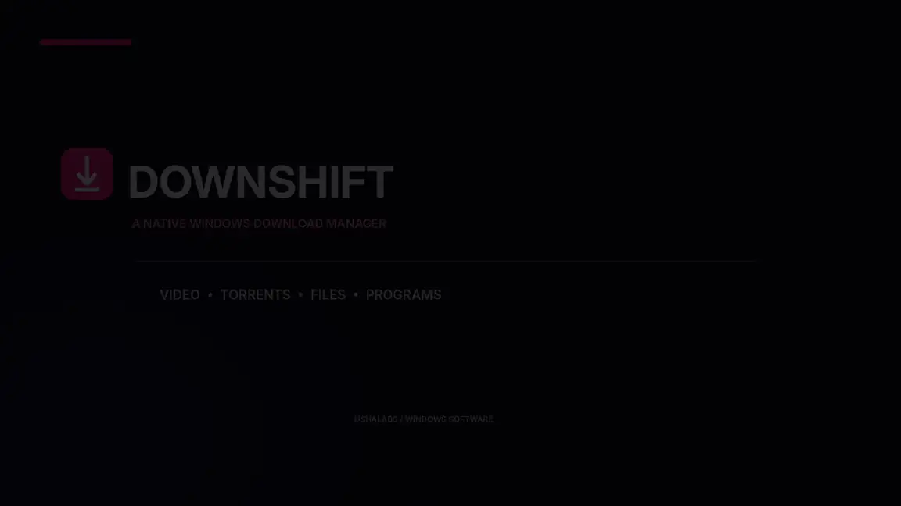

<h1 align="center">
  
  <br />
  Downshift
</h1>

<p align="center">
  <a href="https://hub.xerj.org/contributors/ushalabs"></a>
  
  
  
  
  
</p>

<p align="center">
  <strong>An all-in-one download manager for Windows.</strong><br />
  Fast file downloads, video downloads, torrent support, browser integration, and a modern native desktop experience.
</p>

<p align="center">
  <strong>Microsoft Store Soon</strong> • <strong>Android Port Soon</strong>
</p>

---

## About Downshift

**Downshift** is a modern native Windows download manager built to handle different kinds of downloads in one place.

It supports:

- **Regular file downloads**
- **Video downloads**
- **Torrent downloads**
- **Browser-assisted capture**
- **Pause / Resume**
- **Queue and speed management**
- **A modern desktop UI with light and dark theme support**

The goal of Downshift is to provide a clean, fast, and reliable download experience without the outdated feel of older download managers.

---

## Demo

<p align="center">
  
</p>

---

## Features

### All-in-one downloading
Downshift combines multiple download workflows into a single desktop application:

- **HTTP / HTTPS downloads**
- **Video downloads from supported sources**
- **Torrent and magnet downloads**
- **Browser integration**
- **Unified download history**

### Modern desktop UI
Designed with a cleaner and more modern interface than traditional download managers:

- spacious layout
- light and dark theme support
- searchable download list
- categorized sidebar
- live status cards
- detailed download information
- native Windows feel

### Download management
Downshift includes the core controls expected from a serious downloader:

- pause / resume
- cancel
- queueing
- connection controls
- speed visibility
- organized history
- status-based filtering
- settings for behavior and appearance

### Torrent support
Torrent downloads are built directly into the application so users can manage normal downloads and torrents in one place.

### Browser integration
Downshift is designed to work alongside browser download flows to make grabbing supported downloads easier.

---

## Main Interface

<p align="center">
  
</p>

The main dashboard gives a quick overview of:

- total downloads
- active transfers
- total speed
- downloaded data
- in-progress, completed, and attention-needed items
- torrent downloads
- download controls and search

---

## Browser extensions: Chrome, Edge, Firefox and Opera

Install the latest Downshift Windows application first. Open **Settings → Integration → Set up browser extension**, select your browser, and click its setup button. Downshift opens the browser's extension page and copies the required folder or manifest path.

### Google Chrome

1. Open `chrome://extensions` and enable **Developer mode**.
2. Click **Load unpacked**.
3. Press **Ctrl+V** to paste the copied extension folder, then select it.
4. Pin Downshift and leave **Use Downshift for downloads** enabled.

### Microsoft Edge

1. Select **Edge** in Downshift's browser setup, or open `edge://extensions`.
2. Enable **Developer mode** and click **Load unpacked**.
3. Paste the copied Edge extension folder and select it.
4. Pin Downshift and leave **Use Downshift for downloads** enabled.

### Mozilla Firefox

Firefox **140 or newer** is required. The current local build is unsigned and must be loaded temporarily:

1. Select **Firefox** in Downshift's browser setup, or open `about:debugging#/runtime/this-firefox`.
2. Click **Load Temporary Add-on**.
3. Paste the copied `manifest.json` path and open it.
4. Approve the requested access and leave **Use Downshift for downloads** enabled.

Firefox removes temporary add-ons when it closes. Permanent installation requires a Mozilla-signed add-on. This build excludes private windows; Firefox controls its own download panel.

### Opera

1. Select **Opera** in Downshift's browser setup, or open `opera://extensions`.
2. Enable **Developer mode** and click **Load unpacked**.
3. Paste the copied Opera extension folder and select it.
4. Pin Downshift and leave **Use Downshift for downloads** enabled.

For standalone ZIPs, extract the matching browser package first, then select its extracted folder (or `manifest.json` for Firefox). When updating an unpacked extension, click **Reload** on its extension card and refresh open video pages.

Official loading guides: [Chrome](https://developer.chrome.com/docs/extensions/get-started/tutorial/hello-world#load-unpacked), [Edge](https://learn.microsoft.com/en-us/microsoft-edge/extensions/getting-started/extension-sideloading), [Firefox](https://extensionworkshop.com/documentation/develop/temporary-installation-in-firefox/), [Opera](https://help.opera.com/en/extensions/testing/).

The compact pink circular icon at the top of a detected video opens the existing quality/download flow. Hover over the icon to reveal **×** and hide it for that video. A new video or page reload restores the control. Download links and selected media metadata are shared with the local Downshift app; see [extension privacy](extension/PRIVACY.md) and the [browser setup guide](docs/BROWSER_EXTENSIONS.md). Protected or unavailable media may not be downloadable.

---

## Tech Stack

Downshift is built with:

- **C++20**
- **Qt 6**
- **libcurl**
- **SQLite**
- **Rasterbar libtorrent**
- **CMake**
- **MSVC / Visual Studio**
- **Windows-native packaging**

This project is focused on native desktop performance, modern UI, and real-world usability.

---

## Settings

The settings screen allows configuration for things like:

- download folder
- simultaneous downloads
- downloads per site
- connections per site
- connections per download
- total speed limit
- appearance
- integration-related behavior

It also carries the **UshaLabs** branding as part of the project identity.

---

## Project Status

### Windows
The Windows version is the primary version of Downshift and is currently the main focus.

### Microsoft Store
**Microsoft Store release is planned soon.**

### Android
An **Android port is planned soon** to extend Downshift beyond desktop and bring the same all-in-one idea to mobile.

---

## Why this project matters

Downshift is not just a UI showcase — it is a real software engineering project built around:

- native desktop development
- networking
- download workflows
- torrent integration
- file handling
- UI/UX design
- packaging and deployment

It is being developed as both a usable application and a strong portfolio project.

---

## Repository Structure

```text
Downshift-Downloader/
├── assets/
├── docs/
├── extension/
├── packaging/
├── scripts/
├── src/
├── tests/
├── CMakeLists.txt
└── README.md
```
