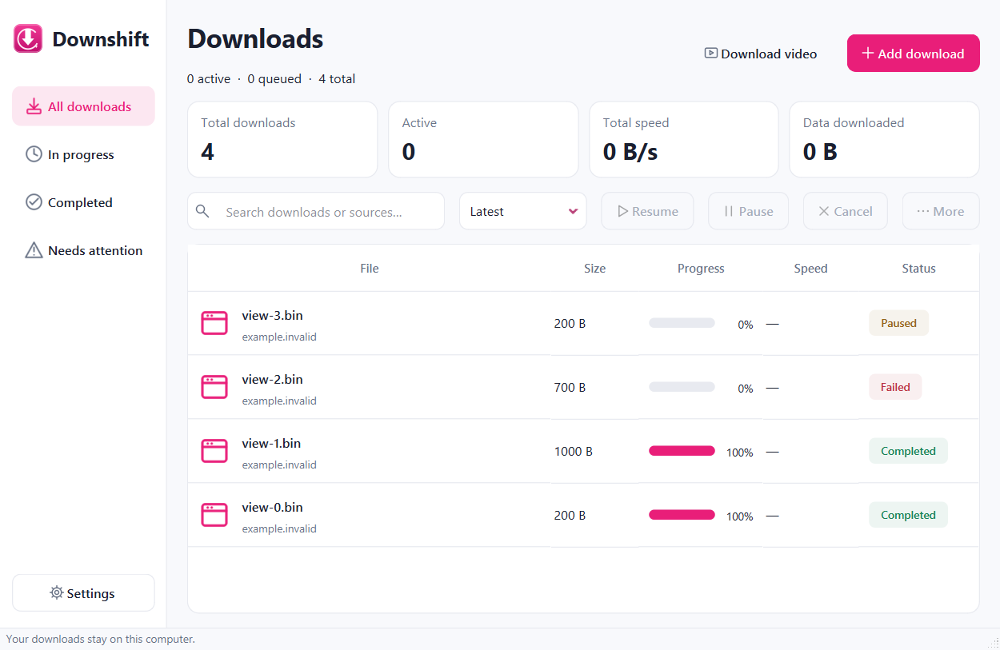

# Downshift

The 0.4.2 development history repair and storage-binding recovery procedure are documented in [HISTORY_RECOVERY.md](docs/HISTORY_RECOVERY.md). Public release artifacts remain at the separately verified v0.3.3 preview.

Native BitTorrent Phases T1–T2 provide a Rasterbar engine, encrypted torrent recovery, selection/limits/seeding controls and a developer console: see [torrent scope and usage](docs/TORRENTS.md). Torrent GUI is the separately approved T3 phase.

The working HTTP/GUI version is **0.4.2 — history storage repair, independent range connections and GUI 2.0**: neutral light/dark themes, responsive navigation/search, painted download rows, contextual details, sectioned Settings and the pink arrow icon. Startup distinguishes loading/failure from empty history and checks recovered storage identity. Segmented HTTP/2 downloads use independent reusable connections. See [performance diagnosis](docs/PERFORMANCE.md), [GUI 2.0](docs/GUI_2.md) and [history recovery](docs/HISTORY_RECOVERY.md). The verified published preview remains v0.3.3. The separate torrent subsystem is not yet a GUI feature.


Downshift is a free, open-source Windows download manager for ordinary files and supported videos. It uses a native C++20/Qt desktop, libcurl download engine, encrypted SQLite history and a Chrome extension. The 0.3.3 repair negotiates server capabilities, falls back to complete responses when safe ranges are unavailable, and handles supported HTTP content encoding. Browser handoff, verified recovery, quality choices, newest-first history and rounded pink forms share one native application.



GUI 2.0 render with synthetic history fixtures; counts and files shown are test data.

## Get started

Get the Windows x64 portable archive from [verified v0.3.3 preview](https://github.com/ushalabs/Downshift-Download-Manager/releases/tag/v0.3.3). Extract the **whole ZIP** to a permanent writable folder and run **Setup.cmd**. Open the Desktop Downshift shortcut or Downshift.exe beside its DLLs. Windows 10/11 x64 is required; developer tools are not needed.

For Chrome, open `chrome://extensions`, enable **Developer mode**, choose **Load unpacked**, and select the extracted package's **extension** folder. Reload existing video pages. A previously installed extension needs **Reload** after an update. Capture defaults on for fresh installs; saved off preferences persist. [Full setup](docs/PACKAGING.md) and [Chrome recovery](docs/CHROME.md) explain moving or uninstalling the package.

For video extraction/quality selection and merging, run **Enable-video.cmd** once. It downloads pinned, checksum-verified upstream yt-dlp, Deno and FFmpeg tools. These optional executables are not redistributed in the portable ZIP. Ordinary file downloads work immediately without them.

## Downloads

| Content | Initial destination |
|---|---|
| Videos | Downloads → Videos |
| Audio | Downloads → Audios |
| ZIP, RAR and other archives | Downloads → Zip |
| Programs and all other files | Downloads → Programs |

Choose another location for any download. Settings can change the base folder. Existing history/files are preserved. Categories use filename/media type, not full-content decoding. Chrome handoffs open Downshift and a destination window before native transfer starts. Video records appear in All downloads and Completed; completion requires a verified saved local video, with its actual path and Open folder action.

Enabled capture promptly pauses Chrome and does not silently fall back when a handoff fails. Retry in the popup or turn capture off to use Chrome. Chrome may receive initial bytes or finish small files before its extension reports them; universal replacement cannot be guaranteed. Browser cookies/credentials are not imported. Authenticated, dangerous, incognito, browser-only, protected and unsupported resources have explicit limits. Player controls work on detected supported videos, including YouTube; they do not make every website or DRM stream downloadable. [Behavior and limits](docs/GENERAL_DOWNLOADS.md), [video support](docs/MEDIA.md).

## Native engine and desktop

- Adaptive segmented transfers with automatic tuning or fixed 1–16 connection limits; streaming for servers without safe range capability.
- TLS verification, exact range/length checks, strong ETag pinning for resume, optional trusted SHA-256, exclusive partial files and completion without overwriting existing files.
- Encrypted crash-recovery checkpoints, bounded transient retries, pause/resume and explicit safe restart when resumability is unavailable.
- Persistent queue/history, priorities, file concurrency/site limits and global/per-file pacing; video tasks have a separate helper concurrency/rate budget.
- Live progress/speed/ETA, searchable history, compact responsive pink/plum themes and wider details when maximized. Downloads are never executed automatically.

## Verification and performance

T2 regression coverage includes 18 groups for HTTP/HTTPS, transport, recovery, queue, GUI, media, browser/protocol, storage and torrents. Release passed its full run; Debug required an isolated retry of the T1 local-seeder fixture. Both final torrent suites passed 246 management checks and 142 foundation checks. [Recorded evidence](docs/DEVELOPMENT_PROGRESS.md) distinguishes complete runs, final affected-group reruns, Windows CI and release verification. Earlier exact-source T1 CI passed 17 Release/17 Debug groups and 13 existing HTTP/GUI portable checks; actual isolated Chrome runs belong to that earlier verification. No fresh-VM, public-swarm or packaged torrent acceptance is claimed.

Phase 8 retained **180 independently verified samples**, 90 pairs over 30 loopback cases with 100 MB/1 GB/5 GB files. [Measured results and provenance](docs/PERFORMANCE.md) include gains and regressions. They are cached HTTP/1.1 loopback measurements on one laptop, not Internet/physical-storage throughput. No direct speed advantage over IDM has been established.

## Build from source

Install Visual Studio 2022/Build Tools with Desktop development with C++, MSVC v143 and a Windows SDK, plus Git, CMake 3.25+ and Python 3.10+ for tests. Node is used for extension controller tests. Python/Node are not required by the app.

```powershell
./scripts/Bootstrap.ps1
./scripts/Test-Environment.ps1
cmake --preset windows-msvc
cmake --build --preset release --parallel 2
./scripts/Install-MediaTools.ps1 -Configuration Release
ctest --preset release
cmake --build --preset debug --parallel 2
./scripts/Install-MediaTools.ps1 -Configuration Debug
ctest --preset debug
./build/windows-msvc/Release/Downshift.exe
```

Bootstrap pins vcpkg to the manifest baseline and finds Visual Studio's bundled CMake. Keep bootstrap and configure in the same PowerShell session. The first source dependency build takes substantial time/space. Source developer details are in [installation](docs/INSTALLATION.md). Packaging a clean, tested Release uses `scripts/Build-Portable.ps1 -RequireClean` and `scripts/Test-Portable.ps1`.

## Documentation and license

[Architecture](docs/ARCHITECTURE.md) · [desktop](docs/DESKTOP.md) · [queue](docs/QUEUE.md) · [recovery](docs/RECOVERY.md) · [tests](docs/TESTING.md) · [packaging](docs/PACKAGING.md) · [release notes](docs/RELEASE_NOTES.md) · [development progress](docs/DEVELOPMENT_PROGRESS.md).

Original Downshift source is [MIT](LICENSE). Libraries retain their own terms. Shared Qt uses the LGPLv3 option; the binary includes complete notices/license texts, and the matching release provides corresponding dependency sources/patches/build recipes. Library replacement is permitted. [Third-party notices](docs/THIRD_PARTY_NOTICES.md) and [library rebuilding](docs/REBUILD_LIBRARIES.md) describe the shipped inventory and replacement rights. The unsigned preview has no Windows installer, Chrome Web Store publication or automatic updater.
